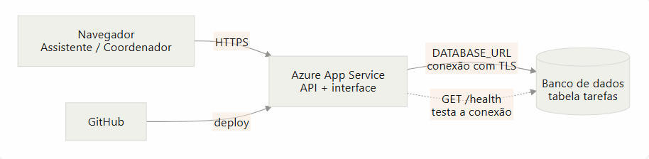
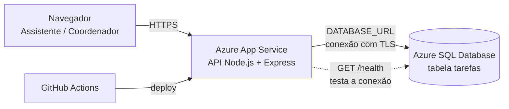

# G01 · Mural da Coordenação

Cloud Challenge · Computação em Nuvem · SENAC 2026.2 · Turma TADS-046

## Equipe

| Integrante | Papel | Responde por |
|---|---|---|
| Heitor Galdino da Silva | NUVEM | Recursos na Azure, variáveis de ambiente, firewall, deploy e logs |
| Lucas Felipe Vaz de Lima Leite | DEV | Rotas, regras de negócio e interface |
| Mayara Vithoria | DADOS | Modelo de dados, tabelas, restrições, consultas e prova de persistência |
| Maria Julia Lacet | QA | Casos de teste, evidências, README e pitch |

Todos os integrantes sabem explicar o fluxo completo do produto, do navegador até o banco.

Nível de implantação alcançado: **A (nuvem completa)**, com aplicação no Azure App Service e banco gerenciado Azure SQL criados pelo grupo.

URL pública: https://app-cloud-g01-hgs-a5cbhgecgmfbb4ba.brazilsouth-01.azurewebsites.net/api/tarefas?situacao=atrasadas / https://app-cloud-g01-hgs-a5cbhgecgmfbb4ba.brazilsouth-01.azurewebsites.net/api/tarefas

---

## 1. Problema e usuário

A coordenação acadêmica controla suas tarefas (reservar o auditório, publicar horários, conferir diários, enviar comunicados) em post-its e grupos de mensagem. As tarefas se perdem e ninguém sabe o que está atrasado. O usuário é o assistente acadêmico ou coordenador, usando o computador da secretaria. O Mural reúne as tarefas com responsável e prazo e mostra imediatamente o que está atrasado.

## 2. Requisitos e status

| Requisito | Descrição | Status | Evidência |
|---|---|---|---|
| RF1 | Cadastrar tarefa (título de 3 a 120 caracteres, responsável, prazo opcional, prioridade baixa/média/alta com padrão média) | Feito | Testes T1 a T3 |
| RF2 | Listar tarefas com filtro por situação (pendentes, concluídas, atrasadas) | Feito | Teste T7 e prints CA4 |
| RF3 | Concluir tarefa registrando data e hora (**regra central**) | Feito | Teste T4, print CA3 |
| RF4 | Filtro "atrasadas": prazo anterior a hoje e tarefa não concluída (**regra central**) | Feito | Teste T5, prints CA4 |
| RF5 | Excluir tarefa | Feito | Teste T6 |
| Extra | Rota `GET /health` que testa a conexão com o banco | Feito | E1, E2 |

## 3. Arquitetura





Caminho de uma requisição: o navegador chama a API pelo HTTPS do App Service, a API valida a entrada no servidor, abre a conexão com o Azure SQL usando a string da variável de ambiente `DATABASE_URL` e executa consultas parametrizadas. O resultado volta em JSON.

### Decisão justificada: Azure SQL Database (oferta gratuita, serverless)

| O que ganhamos | O que perdemos |
|---|---|
| Custo zero dentro do limite gratuito da assinatura | Pausa automática ao esgotar o limite gratuito do mês |
| Banco gerenciado: backup, patches e disponibilidade sem administrar servidor | No modo serverless, a primeira requisição depois de um período parado pode demorar alguns segundos |
| Integração direta com o App Service e com o editor de consultas do portal | Sintaxe T-SQL em vez de PostgreSQL (ex.: paginação com `OFFSET ... FETCH`) |

Também consideramos instalar o banco numa VM, mas isso traria patch, backup e segurança por nossa conta, além de custo por hora, sem ganho para um produto deste tamanho.

## 4. Modelo de dados

Tabela `tarefas` (script completo em `banco/schema.sql`):

| Coluna | Tipo | Restrições |
|---|---|---|
| `id` | `INT IDENTITY(1,1)` | `NOT NULL`, identificador gerado pelo banco |
| `titulo` | `NVARCHAR(120)` | `NOT NULL` (o mínimo de 3 caracteres é validado no servidor) |
| `responsavel` | `NVARCHAR(100)` | `NOT NULL` |
| `prioridade` | `VARCHAR(10)` | `NOT NULL`, padrão `media` (valores aceitos: `baixa`, `media`, `alta`) |
| `prazo` | `DATE` | aceita `NULL` (prazo é opcional) |
| `concluida_em` | `DATETIMEOFFSET` | `NULL` enquanto a tarefa está pendente |
| `criada_em` | `DATETIMEOFFSET` | data e hora do cadastro, com fuso |

No Azure SQL, `DATETIMEOFFSET` faz o papel do `TIMESTAMPTZ` do PostgreSQL: guarda o instante junto com o fuso, o que evita o erro de 3 horas de diferença entre o App Service (UTC) e Brasília.

### Decisões do grupo

| Pergunta | Decisão |
|---|---|
| Exclusão física (`DELETE`) ou lógica? | **Física.** `DELETE /api/tarefas/:id` remove a linha, e um id que não existe devolve 404. A tabela não tem coluna de "excluída". Para um mural simples isso mantém o modelo enxuto; o que se perde é o histórico de tarefas apagadas. |
| A situação é uma coluna ou derivada de `concluida_em`? | **Derivada.** Não existe coluna de status: a tarefa está pendente quando `concluida_em` é `NULL` e concluída quando está preenchido. Assim a situação nunca fica em desacordo com a data de conclusão. |
| "Atrasada" é calculada no SQL ou na aplicação? | **No SQL.** A consulta compara o `prazo` com a data de hoje e exige `concluida_em IS NULL`. A API devolve o resultado no campo `atrasada` e no filtro `?situacao=atrasadas`. |
| Qual é o "hoje": UTC do servidor ou Brasília? | **Brasília.** O App Service usa UTC, e depois das 21h em Brasília já é "amanhã" em UTC, o que marcaria tarefas como atrasadas cedo demais. Por isso o "hoje" é calculado no SQL com `AT TIME ZONE 'E. South America Standard Time'`. |

## 5. Como executar

### Pré-requisitos

Node.js 20 ou superior e acesso a um banco Azure SQL.

### Variáveis de ambiente

Copie `.env.example` para `.env` e preencha. O `.env` está no `.gitignore` e nunca vai para o Git.

| Variável | Para que serve |
|---|---|
| `DATABASE_URL` | String de conexão com o Azure SQL (formato `Server=tcp:SERVIDOR.database.windows.net,1433;Initial Catalog=BANCO;User ID=USUARIO;Password=SENHA;Encrypt=True;Connection Timeout=30;`) |
| `PORT` | Porta da aplicação (padrão 3000 localmente; no App Service quem define é a plataforma) |

### Banco de dados

Execute, nesta ordem, no Editor de Consultas do portal do Azure ou em outro cliente SQL:

1. `banco/schema.sql` (cria a tabela e as restrições)
2. `banco/usuario-app.sql` (cria o usuário da aplicação com permissão só de `SELECT`, `INSERT`, `UPDATE` e `DELETE` em `dbo.tarefas`; **troque a senha de exemplo por uma própria**)
3. `banco/dados-iniciais.sql` (opcional, dados fictícios)

### Aplicação

```bash
npm install
npm run dev     # desenvolvimento, lê o .env e reinicia ao salvar
npm start       # produção (é o que o App Service executa)
npm test        # 7 testes automatizados (precisa de DATABASE_URL apontando para um banco)
```

As requisições prontas para teste manual estão em `requests.http` (extensão REST Client do VS Code).

### Implantação na Azure

- Grupo de recursos `rg-cloud-g01`, região Brazil South.
- Azure SQL Database gratuito (serverless) no servidor `sql-cloud-g01-hgs`, banco `mural`, com firewall liberando serviços do Azure.
- App Service Linux, plano gratuito F1, aplicativo `app-cloud-g01-hgs`.
- `DATABASE_URL` cadastrada em Variáveis de ambiente do App Service (o valor fica oculto).
- Deploy automático por GitHub Actions (`.github/workflows/main_app-cloud-g01-hgs.yml`) a cada push na `main`.

## 6. Testes (E3)

Os 7 casos abaixo rodam com `npm test` (print em `evidencias/e3-npm-test.png`). Os casos negativos estão em **negrito**.

| # | Caso | Esperado | Obtido |
|---|---|---|---|
| T1 | `GET /health` | 200 com `iniciado_em` | Passou |
| T2 | **CA1: título com 2 caracteres** | 400 com mensagem | Passou |
| T3 | **CA2: prazo anterior a hoje** | 400 | Passou |
| T4 | **CA3: concluir tarefa pendente preenche `concluida_em`; concluir de novo** | 200; segunda vez 409 | Passou |
| T5 | CA4: filtro "atrasadas" com uma pendente e uma concluída, ambas com prazo de ontem | só a pendente | Passou |
| T6 | **CA5: excluir id inexistente** | 404 | Passou |
| T7 | **Filtro de situação inválido** | 400 | Passou |

Provas adicionais na nuvem, contra a URL pública:

- **CA3 (409):** tarefa id 5 concluída com `concluida_em` preenchido, e a segunda tentativa devolveu 409 (`evidencias/ca3-concluir-409.png`).
- **CA4:** com as tarefas 1 (pendente, prazo 08/11) e 2 (concluída, prazo 08/11), `GET /api/tarefas?situacao=atrasadas` devolve só a tarefa 1 (`evidencias/ca4-lista-atrasada-nuvem.png` e `evidencias/ca4-filtro-atrasadas.png`).
- **Preparação do teste:** como o cadastro recusa prazo no passado (CA2), as tarefas com prazo de ontem foram inseridas diretamente no banco, e isso é intencional.
- **Health com banco indisponível:** `/health` devolveu `{"status":"erro","banco":"indisponivel"}` sem expor nenhum detalhe interno (`evidencias/e3-health-503.png`).

## 7. Evidências

| Código | Evidência | Arquivo |
|---|---|---|
| E1 | URL pública e `/health` ok | `evidencias/e1-health-url-publica.png` |
| E2 | Prova de persistência (4 prints) | ver abaixo |
| E3 | Casos de teste | seção 6 |
| E4 | Diagrama de arquitetura | seção 3 |
| E5 | Configuração segura | ver abaixo |
| E6 | README e pitch | este arquivo e o link no topo |

### E2: prova de persistência

Registro cadastrado pela aplicação: `G01-PALAVRA`, id 4, criado em 2026-11-09T09:44:42Z.

1. Cadastro e listagem pela aplicação: `e2-print0-cadastro-powershell.png`, `e2-print1-lista.png`
2. `iniciado_em` do `/health` antes do reinício: 2026-11-09T09:41:11Z (`e2-print2-health-antes.png`)
3. Depois do reinício, `iniciado_em` mudou para 2026-11-09T09:47:42Z e o registro continua listado (`e2-print3-health-depois.png`, `e2-print3-lista-depois.png`)
4. Mesma linha numa consulta direta ao Azure SQL: `SELECT ... FROM dbo.tarefas WHERE titulo LIKE 'G01-%'` (`e2-print4-banco.png`)

### E5: configuração segura

- `.env` no `.gitignore`: `git check-ignore -v .env` mostra a regra e `git ls-files` lista só o `.env.example` (`evidencias/e5-gitignore.png`).
- `DATABASE_URL` cadastrada no App Service com o valor oculto (`evidencias/E5.png`).
- Consultas parametrizadas, validação no servidor e mensagens de erro sem detalhes internos.
- Usuário do banco sem privilégio de administrador: `app_mural` só pode `SELECT`, `INSERT`, `UPDATE` e `DELETE` em `dbo.tarefas`.

## 8. Dificuldades superadas

**Workflow de deploy falhando no build**

- **Problema:** o primeiro run do GitHub Actions terminou em falha no job `build` (19 s), e o `deploy` nem rodou.
- **Diagnóstico:** o build executava `npm test`, e os testes dependem de uma conexão com o Azure SQL, que o ambiente do Actions não tem.
- **Causa:** os testes de integração foram incluídos num workflow sem acesso ao banco.
- **Solução:** removemos a etapa de testes do workflow (commit "Remove testes do workflow: dependem do banco Azure SQL"). Os testes continuam sendo executados localmente com `npm test`, e o deploy passou a funcionar.

**Push recusado no Git**

- **Problema:** `git push` falhou com erro 403 (permissão negada) e com o erro GH007 (e-mail privado).
- **Causa:** o computador estava autenticado em outra conta do GitHub e o e-mail pessoal estava protegido pelas configurações de privacidade.
- **Solução:** passamos a autenticar com a conta dona do repositório (`HeitorGaldinodaSilva`) e ajustamos o e-mail dos commits para respeitar a configuração de privacidade do GitHub. Depois disso os pushes e o deploy passaram a funcionar.

## 9. Limitações conhecidas e próximos passos

- Não há login: qualquer pessoa com a URL consegue criar, concluir e excluir tarefas. Próximo passo: autenticação (por exemplo, Microsoft Entra ID).
- O banco serverless gratuito pausa quando o limite do mês acaba, e a primeira requisição após a pausa pode falhar ou demorar.
- Segredos: durante o desenvolvimento a senha de teste do usuário `app_mural` apareceu em um script e em prints. Ela foi removida do script e substituída, e o valor atual existe apenas na variável de ambiente `DATABASE_URL`. Lição aprendida: nunca colocar senha em arquivo versionado nem em print.
- Extras ainda não feitos: filtro por responsável, ordenação por prioridade e prazo, contadores e reabrir tarefa concluída.
- Limpeza: ao final, excluir o grupo de recursos `rg-cloud-g01` na data informada pelo professor.
